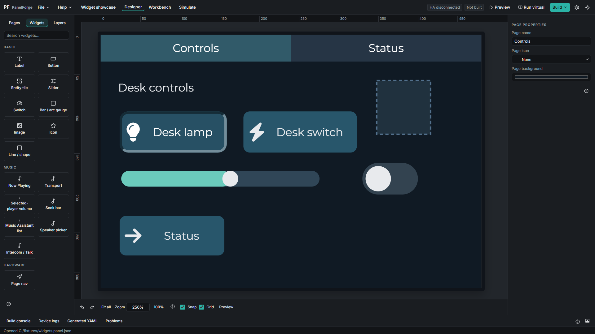
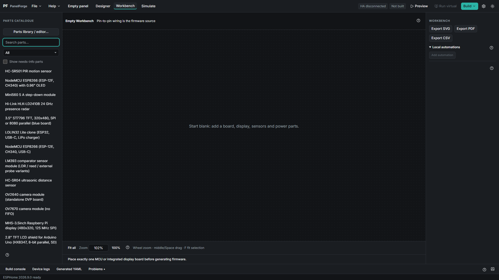

# PanelForge

A Windows visual designer for ESPHome touch panels. Build screens in Designer, place and wire physical parts in Workbench, simulate inputs, and validate/compile firmware. Home Assistant integration, an optional SDL virtual panel, custom YAML blocks and an offline illustrated manual are included.

By **Fumby**. Application code: **MIT**, copyright2026. This is an early pre-release; supported board maps remain UNVERIFIED until tested on real hardware.

## Requirements

- Windows10 or11, x64. Windows ARM is **untested**; no ARM compatibility claim is made.
- Microsoft Edge WebView2 Runtime. The installer can obtain its bootstrapper when needed.
- Internet access for first-run Python/ESPHome and the first selected ESP toolchain download; subsequent use reuses local caches.
- Plan for several GB of free disk space (8GB or more is a sensible starting allowance). WSL2/WSLg, a Linux distro and SDL development libraries are additionally needed only for Run virtual.
- Home Assistant is optional for local-only panels. Connected actions require a reachable HA instance and the correct permissions.

## Install

1. Open [Releases](https://github.com/Fumby01/panelforge-releases/releases) and download the Windows x64 installer and matching SHA256 file.
2. Check the installer using PowerShell: `Get-FileHash .\PanelForge_<version>_x64-setup.exe -Algorithm SHA256`; compare the complete hash with the supplied checksum.
3. Run the installer for your current Windows user. The build is unsigned: Windows SmartScreen may show a warning. If you have verified the file and choose to proceed, select **More info -> Run anyway**. Do not disable Defender or other protections.
4. Start PanelForge, read the safety/privacy notice, and choose Continue to prepare the managed tools. Progress appears in the console.
5. Press **F1** for Getting started and the offline manual. Start with an integrated panel or a blank wired project; confirm the actual board/module revision before generating firmware.

### First-run downloads and time

Planning estimates, not a completed clean-machine benchmark: Python/ESPHome setup can download roughly200-500MB and take5-15minutes. The first firmware compile can download another1-3GB of ESP-IDF/compiler packages and take10-45minutes. Several GB of caches/build output remain on disk. Bandwidth, CPU, cached tools and selected chip change these numbers. Optional WSL/distro/SDL installation adds its own downloads and time. Clean-machine and hardware acceptance remain owner checks; do not interpret these estimates as a guarantee.

## Hardware safety

**No warranty: check wiring, voltage and battery polarity before powering. Lithium cells can be dangerous.** Confirm component ratings, charger/protection, cell count, polarity and common ground. With power disconnected, check for shorts between3V3,5V and GND. Successful validation/compilation and simulation cannot verify a real circuit. The wiring assistant reports insufficient or incompatible pins rather than using reserved hardware connections. A CYD cannot accept every peripheral combination simply because it has an ESP32.

## Privacy

No telemetry. HA tokens stay in Windows Credential Manager. Network traffic is limited to HA/ESPHome connections, tool downloads and update/browser requests you explicitly start. **Help -> Check for updates** is manual only; there is no automatic polling, download or install. **Help -> Export diagnostics** saves a scrubbed ZIP locally and never uploads it automatically. Review it before sharing; ordinary logs can still describe your project or devices.

## Report a problem

Open [Issues](https://github.com/Fumby01/panelforge-releases/issues). Include what you did, expected behaviour, actual result, app version and a screenshot. Attach the ZIP from **Help -> Export diagnostics**. Never attach secrets.yaml, a HA token, Wi-Fi passwords or unreviewed raw logs. For hardware reports, include the exact board/module revision and pin labels; never assume an unverified clone matches a reference profile.

## Licence and third-party assets

PanelForge application code is [MIT](LICENSE), with no warranty. See [THIRD_PARTY_NOTICES.md](THIRD_PARTY_NOTICES.md) for dependency, font and drawing licences/attribution. Python, ESPHome, ESP-IDF and compiler tools are downloaded at runtime, not bundled in the installer.

**Non-commercial drawings remain separately restricted:** board-s3, board-s3-n16r8, ili9341-xpt2046, sht30 and tp4056 currently use CC-BY-NC-SA artwork. The app's MIT licence does not relicense those drawings or clear the packaged artwork for commercial redistribution. Other attribution/share-alike obligations remain. Drawing sources/licences are provided with releases in third-party-artwork.zip.
